  

  
  
  

---

## 👋 Sobre mí

Soy **Data Engineer** con casi 3 años construyendo plataformas de datos **cloud-native sobre Google Cloud**. Hoy trabajo en **RIMAC Seguros** convirtiendo datos estructurados y no estructurados (audios, documentos, siniestros de salud) en datasets **confiables, gobernados y listos para IA**.

Me interesa la parte de la ingeniería que hace que la IA funcione de verdad en producción: ingesta event-driven, calidad de datos, arquitectura Medallion, infraestructura como código y costos bajo control.

- 🏥 **Ahora:** pipelines de procesamiento documental para siniestros de salud — ingesta por eventos, OCR, clasificación y datasets AI-ready.
- ☁️ **Multi-cloud:** framework reutilizable en Terraform para ingesta segura entre AWS S3 y Google Cloud Storage.
- 🎓 Ingeniería de Software — Universidad Nacional Mayor de San Marcos.

---

## 📈 Impacto medible

| Resultado | Cómo |
|:--|:--|
| ⚡ **6 horas → 1 minuto** en reportería regulatoria | Automatización con Python y PL/SQL sobre Oracle (Claro Perú) |
| 🔄 **Semanal → diario** en frescura de datos de audio para IA Generativa | Rediseño y orquestación de pipelines batch con Cloud Composer |
| 📡 **Visibilidad casi en tiempo real** del Call Center | Pipeline end-to-end Five9 → Pub/Sub → Cloud Functions → Workflows → Dataflow → dashboards |
| 💰 **Gobierno de costos cloud** (FinOps) | Etiquetado automático de recursos con Composer + Terraform y Billing / INFORMATION_SCHEMA en BigQuery |

---

## 🛠️ Stack

**Datos y Cloud**

  
  
  
  
  
  
  
  
  
  
  

**Lenguajes y modelado**

  
  
  
  
  
  
  

**DevOps e IaC**

  
  
  
  
  

**IA y desarrollo de producto**

  
  
  
  

---

## 🚀 Proyectos destacados

<table>
  <tr>
    <td width="50%" valign="top">
      <h3><a href="https://github.com/tonninors/fitnessai-connect">🏋️ FitnessAI Connect</a></h3>
      
Plataforma full-stack open source que genera planes de entrenamiento con IA (LLaMA 4 vía Groq) y guía cada sesión en vivo. La IA propone; la base de datos acota: sustitución de ejercicios con una <b>huella biomecánica determinista</b>, chat en tiempo real y tests con Vitest.

      

        
        
        
        
      

    </td>
    <td width="50%" align="center" valign="middle">
      
    </td>
  </tr>
  <tr>
    <td width="50%" valign="top">
      <h3><a href="https://github.com/tonninors/curso-data-ai">🧱 Curso Data AI Engineering</a></h3>
      
Pipeline <b>Medallion (bronze → silver → gold)</b> sobre una tienda ficticia, con un <b>LLM local como paso del pipeline</b>: salida estructurada validada con Pydantic, caché por hash, cuarentena de filas y evaluación contra etiquetas humanas.

      

        
        
        
        
      

    </td>
    <td width="50%" valign="top">
      <h3><a href="https://github.com/tonninors/aws_practi">☁️ Guías interactivas AWS</a></h3>
      
App web en español para preparar las certificaciones <b>AWS AI Practitioner</b> y <b>Cloud Practitioner</b>: 138 preguntas con los 4 formatos oficiales, simulacro cronometrado con puntaje escalado, repaso adaptativo y progreso en la nube con Supabase.

      

        
        
        
      

    </td>
  </tr>
  <tr>
    <td width="50%" valign="top">
      <h3><a href="https://github.com/tonninors/terminal_bench_v1">🧪 Terminal Bench: SQLite WAL crash recovery</a></h3>
      
Tarea de evaluación de <b>agentes de IA</b> (dificultad alta) sobre recuperación de una base SQLite tras un crash: generador de casos, solución oráculo, verificador y matriz de negativos, todo reproducible y sin red.

      

        
        
        
      

    </td>
    <td width="50%" valign="top">
      <h3><a href="https://github.com/tonninors/tyba-examen-sql">🔍 SQL en Databricks: casos trampa</a></h3>
      
Modelo bancario con <b>10 ejercicios graduados</b> diseñados alrededor de errores reales: LEFT JOIN degradado a INNER, monedas mezcladas, granularidad cuenta vs. cliente y <code>SUM()</code> sobre cero filas.

      

        
        
      

    </td>
  </tr>
</table>

---

## 💼 Trayectoria

| Periodo | Rol | Empresa |
|:--|:--|:--|
| 2026 — hoy | Data Engineer · Health Claims | RIMAC Seguros |
| 2024 — 2025 | Data Engineer · COE GenAI | RIMAC Seguros |
| 2024 | Data Engineer · Generative AI y FinOps | Vooxell |
| 2023 | Network Performance Intern (datos y automatización) | Claro Perú |

---

## 🤝 Trabajemos juntos

Busco retos en **Data Engineering, plataformas de datos para IA y Cloud (GCP / multi-cloud)**, en remoto o híbrido.
Si tu equipo necesita llevar datos a producción de forma confiable, escríbeme:

  

